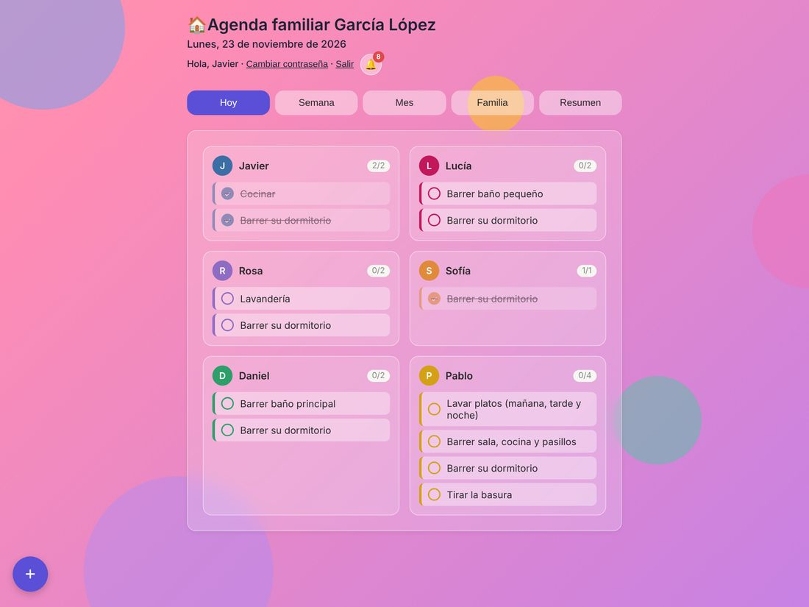
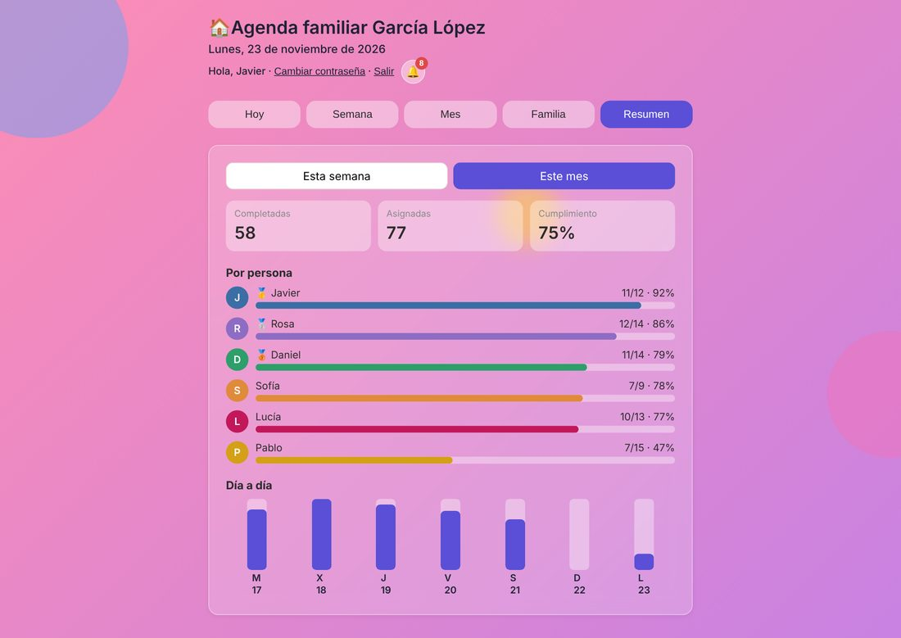
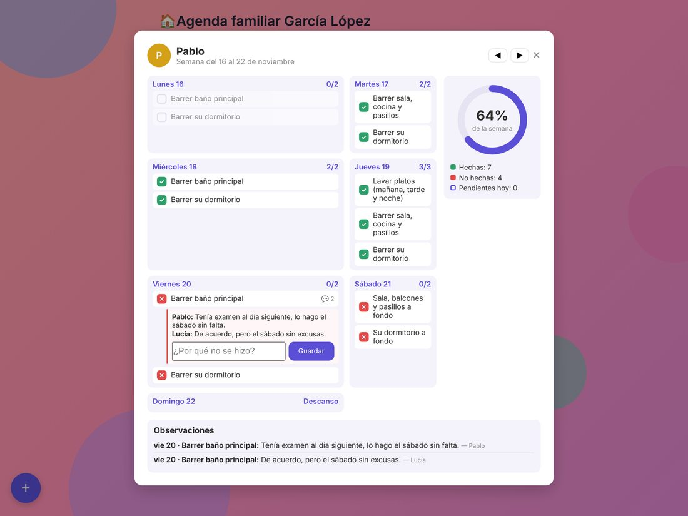
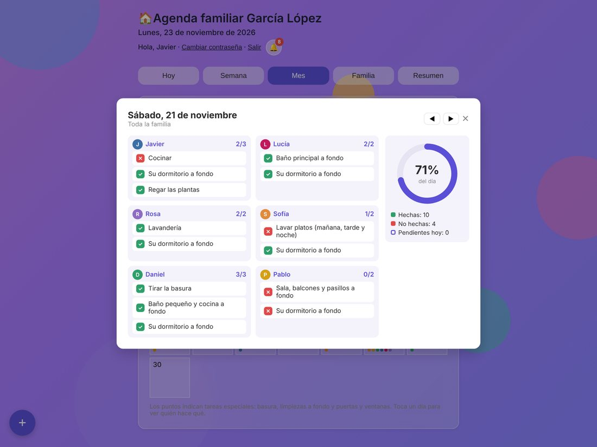
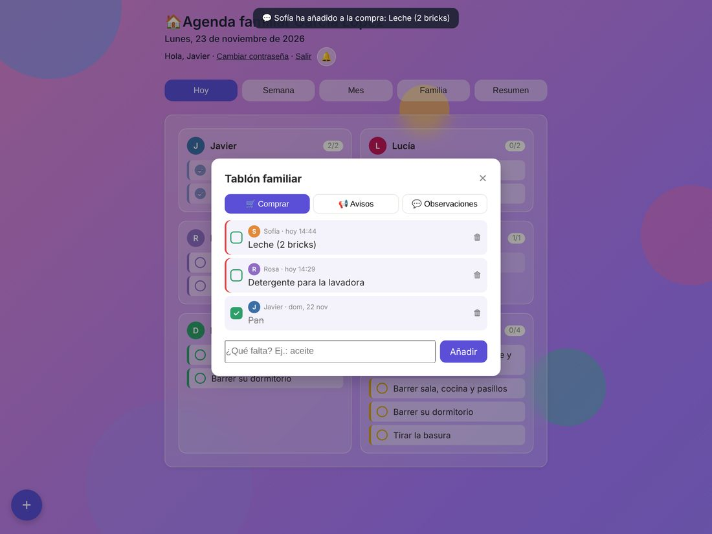
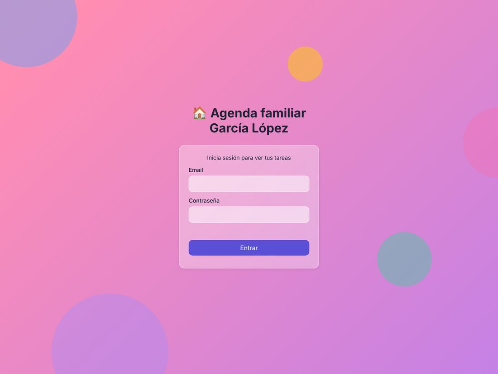
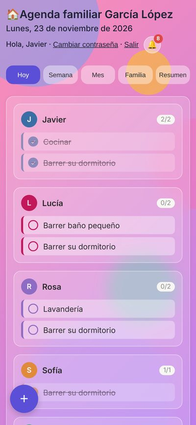

# 🏠 Agenda familiar

Web app para **repartir las tareas del hogar** entre los miembros de una familia. Cada persona tiene su cuenta, marca lo que hace desde el móvil y todos ven los cambios al momento. Incluye estadísticas, un tablón con la lista de la compra y avisos, y notificaciones en el móvil aunque la app esté cerrada.

**▶️ Demo en vivo:** [ENLACE_DE_LA_DEMO](ENLACE_DE_LA_DEMO) · entra con cualquier email y contraseña.

> Esta es la versión pública del proyecto, con una familia ficticia (García López). La versión real la usa a diario mi familia, con sus propias cuentas.

<p align="center">
  
</p>

## Modo demostración

Si en `app.js` no se pone una URL real de Supabase, el archivo `demo.js` simula la base de datos en memoria: genera tres semanas de tareas hechas y sin hacer, observaciones, lista de la compra y avisos. Así cualquiera puede probar la app sin crear cuentas. Los cambios no se guardan al recargar, y las notificaciones push no están disponibles en la demo.

Con una URL real (`https://...supabase.co`), la app usa Supabase de verdad, sin tocar nada más.

## Funcionalidades

- **Reparto automático por turnos**: tareas diarias, semanales, mensuales o cada N días, con rotación entre responsables.
- **Reglas por día de la semana**: tareas solo de lunes a viernes, domingos libres, tareas opcionales y tareas que dependen de otras (por ejemplo, *lavar platos* solo si alguien cocinó).
- **Vistas Hoy, Semana, Mes y Familia** para ver qué toca y a quién.
- **Resumen** con métricas, ranking con medallas y gráfico día a día.
- **Ficha de registro** semanal (por persona) o diaria (toda la familia), con anillo de porcentaje y estados ✓ hecha / ✕ no hecha / pendiente.
- **Observaciones** por tarea para explicar por qué no se hizo algo.
- **Tablón familiar**: lista de la compra y avisos, con campanita de no leídos.
- **Tiempo real**: lo que marca una persona aparece al instante en los demás dispositivos.
- **Notificaciones push** en el móvil (Android e iPhone con la app instalada) cuando alguien escribe en el tablón.
- **Cuentas y permisos**: cada persona marca sus tareas; los administradores gestionan las tareas y pueden marcar las de todos.
- **PWA instalable** con icono propio, diseño adaptado al móvil y efecto cristal sobre fondo animado.

## Capturas

| Resumen | Ficha semanal con observaciones |
| --- | --- |
|  |  |

| Ficha de un día | Tablón familiar |
| --- | --- |
|  |  |

| Inicio de sesión | Móvil |
| --- | --- |
|  |  |

## Tecnologías

| Parte | Tecnología |
| --- | --- |
| Interfaz | HTML, CSS y JavaScript puro (sin frameworks) |
| Base de datos y usuarios | [Supabase](https://supabase.com): PostgreSQL, Auth, Row Level Security y Realtime |
| Notificaciones | Service Worker, Web Push (claves VAPID) y Supabase Edge Function (Deno + TypeScript) |
| Automatización | Database Webhook que llama a la función al insertar una nota |
| Publicación | GitHub + [Netlify](https://netlify.com) con despliegue automático |

## Estructura del proyecto

```
agenda_familiar/
├── index.html              # Estructura de la página y ventanas modales
├── styles.css              # Estilos (secciones numeradas)
├── app.js                  # Lógica de la app (secciones numeradas)
├── sw.js                   # Service worker: recibe y muestra las notificaciones
├── demo.js                 # Modo demostración: base de datos simulada en memoria
├── manifest.json           # Configuración de la app instalable (PWA)
├── base_de_datos.sql       # Tablas, datos iniciales, seguridad y tiempo real
├── *.png                   # Iconos de la app
├── supabase/functions/
│   └── enviar-aviso/
│       └── index.ts        # Función del servidor que envía las notificaciones
└── docs/capturas/          # Imágenes de este README
```

## Modelo de datos

| Tabla | Qué guarda |
| --- | --- |
| `miembros` | Personas de la familia, rol, color, si es administrador y su usuario |
| `tareas` | Título, frecuencia, reparto, responsables en orden de turno, días de la semana y días opcionales |
| `hechas` | Qué tarea hizo cada persona cada día |
| `observaciones` | Notas de tareas, lista de la compra y avisos |
| `suscripciones` | Dispositivos que han activado las notificaciones |

La seguridad está en la propia base de datos (RLS): solo usuarios con sesión pueden leer, cada persona solo puede marcar sus tareas (los administradores, todas) y nadie puede firmar una nota con el nombre de otro.

## Cómo ponerla en marcha

1. **Supabase**: crea un proyecto y ejecuta `base_de_datos.sql` en el *SQL Editor*.
2. **Usuarios**: crea una cuenta por persona en *Authentication* y vincúlala:
   ```sql
   update miembros set usuario_id = (select id from auth.users where email = 'correo@ejemplo.com') where id = 'id_del_miembro';
   ```
3. **Conexión**: en `app.js`, sustituye `TU_URL_DE_SUPABASE` y `TU_CLAVE_PUBLISHABLE` por la URL del proyecto y la clave *publishable*. Cambia también `FECHA_ESTADISTICAS` por el día en que empecéis a usarla.
4. **Publicar**: sube el repositorio a GitHub y conéctalo a Netlify (sin comando de build; carpeta de publicación: la raíz).
5. **Notificaciones** (opcional):
   - Genera un par de claves VAPID y pon la pública en `app.js`, en lugar de `TU_CLAVE_PUBLICA_VAPID`.
   - En Supabase → *Edge Functions → Secrets*, añade `VAPID_PUBLICA`, `VAPID_PRIVADA`, `VAPID_CONTACTO` (`mailto:tu@email`) y `CLAVE_WEBHOOK`.
   - Despliega `supabase/functions/enviar-aviso/index.ts` con el nombre `enviar-aviso` y desactiva la verificación JWT.
   - Crea un *Database Webhook* en la tabla `observaciones` (evento *Insert*) que llame a `enviar-aviso` con la cabecera `x-clave-webhook`.

> La clave privada VAPID y la `CLAVE_WEBHOOK` solo se guardan como secretos en Supabase. Nunca van en el código.

## Qué he aprendido

- Programar una app completa en JavaScript sin frameworks: delegación de eventos, `async/await`, plantillas y manejo de fechas.
- Diseñar una base de datos relacional y protegerla con políticas de seguridad (RLS) y funciones `security definer`.
- Sincronizar varios dispositivos en tiempo real.
- Notificaciones push de extremo a extremo: service worker, suscripción, claves VAPID, función en el servidor y disparador en la base de datos.
- Control de versiones con Git y GitHub, y despliegue continuo con Netlify.
- Depurar con la consola del navegador y los registros del servidor.
- Preparar una versión de demostración que funciona sin servidor, para enseñar el proyecto sin exponer datos reales.

## Autor

**Elias Augusto Nuñez Galarza**

Proyecto personal de aprendizaje, desarrollado paso a paso en VS Code con Claude (Anthropic) como tutor.
